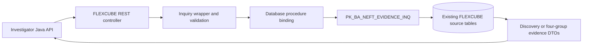

# FLEXCUBE NEFT inquiry APIs

This folder contains the 23 PO01/PO02 extension source files copied from the `pmraut_UAT` working tree on 23 October 2026: **20 Java files and 3 SQL scripts**. The original `FC-CORE/Retail/...` paths and source contents are preserved so each file can be located in the corresponding FLEXCUBE project. Existing copyright notices are retained; this folder does not grant additional rights to the FLEXCUBE platform or its dependencies.

These are the **bank-side inquiry implementations**. The investigator's Spring Boot consumer adapters remain in [`services/api`](../api), with connection settings documented in the [FLEXCUBE integration guide](../../docs/FLEXCUBE_INTEGRATION.md).

## Services and flow

| Service | Purpose | Relative REST path |
| --- | --- | --- |
| PO01 | Discover transactions by exact FCR reference/UTR, or by inquiry date and bounded record count, within the requested bank and branch | `NEFTPaymentDiscoveryInquiryService/processRequest` |
| PO02 | Retrieve PAYMENT, HOST, HISTORY and STATUS evidence for the selected FCR reference and scope | `NEFTEvidenceInquiryService/processRequest` |

Both controllers accept POST JSON requests containing session context in `args0` and inquiry parameters in `args1`. The deployed host and application context are environment configuration and are not supplied here.

The package exposes `AP_BA_NEFT_DISCOVERY_INQ` for PO01 and `AP_BA_NEFT_PAYMENT_INQ`, `AP_BA_NEFT_HOST_INQ`, `AP_BA_NEFT_HISTORY_INQ`, and `AP_BA_NEFT_STATUS_INQ` for PO02. Source status codes and inquiry-service success must be interpreted separately from beneficiary credit or settlement; an empty result group does not prove a successful, complete source query.

## Source layout and inventory

All paths below are relative to this folder. Only these 23 source files are included; IDE metadata, compiled binaries, runtime settings, payment records and branch directories are excluded.

### Database package and service registration — 3 files

- [`PK_BA_NEFT_EVIDENCE_INQ.sql`](FC-CORE/Retail/DBSCRIPTS/Host/ext/packages/PK_BA_NEFT_EVIDENCE_INQ.sql)
- [`PO01.sql`](FC-CORE/Retail/DBSCRIPTS/Host/stp/scripts/day0/system_day0/PO01.sql)
- [`PO02.sql`](FC-CORE/Retail/DBSCRIPTS/Host/stp/scripts/day0/system_day0/PO02.sql)

### REST extension — 4 files

Under `FC-CORE/Retail/HOST/javaprojects/com.ofss.fc.core.rest.ext/src/`:

- [`NEFTPaymentDiscoveryInquiryWrapperController.java`](FC-CORE/Retail/HOST/javaprojects/com.ofss.fc.core.rest.ext/src/com/ofss/fc/api/controller/inquiry/NEFTPaymentDiscoveryInquiryWrapperController.java)
- [`NEFTEvidenceInquiryWrapperController.java`](FC-CORE/Retail/HOST/javaprojects/com.ofss.fc.core.rest.ext/src/com/ofss/fc/api/controller/inquiry/NEFTEvidenceInquiryWrapperController.java)
- [`NEFTPaymentDiscoveryInquiryRequestDTO.java`](FC-CORE/Retail/HOST/javaprojects/com.ofss.fc.core.rest.ext/src/com/ofss/fc/api/model/inquiry/NEFTPaymentDiscoveryInquiryRequestDTO.java)
- [`NEFTEvidenceInquiryRequestDTO.java`](FC-CORE/Retail/HOST/javaprojects/com.ofss.fc.core.rest.ext/src/com/ofss/fc/api/model/inquiry/NEFTEvidenceInquiryRequestDTO.java)

### Interface extension — 16 files

Under `FC-CORE/Retail/HOST/javaprojects/com.ofss.fc.xface.ext/src/`:

| Layer | Files |
| --- | --- |
| Database bindings | [`PkBaNEFTDiscoveryInquiry.java`](FC-CORE/Retail/HOST/javaprojects/com.ofss.fc.xface.ext/src/com/ofss/fc/xface/db/procedure/impl/PkBaNEFTDiscoveryInquiry.java), [`PkBaNEFTEvidenceInquiry.java`](FC-CORE/Retail/HOST/javaprojects/com.ofss.fc.xface.ext/src/com/ofss/fc/xface/db/procedure/impl/PkBaNEFTEvidenceInquiry.java) |
| Discovery record | [`NEFTPaymentDiscoveryDetailsDTO.java`](FC-CORE/Retail/HOST/javaprojects/com.ofss.fc.xface.ext/src/com/ofss/fc/xface/dto/inquiry/NEFTPaymentDiscoveryDetailsDTO.java) |
| Evidence records | [`NEFTEvidenceRecordDTO.java`](FC-CORE/Retail/HOST/javaprojects/com.ofss.fc.xface.ext/src/com/ofss/fc/xface/dto/inquiry/NEFTEvidenceRecordDTO.java), [`NEFTPaymentEvidenceDetailsDTO.java`](FC-CORE/Retail/HOST/javaprojects/com.ofss.fc.xface.ext/src/com/ofss/fc/xface/dto/inquiry/NEFTPaymentEvidenceDetailsDTO.java), [`NEFTHostEvidenceDetailsDTO.java`](FC-CORE/Retail/HOST/javaprojects/com.ofss.fc.xface.ext/src/com/ofss/fc/xface/dto/inquiry/NEFTHostEvidenceDetailsDTO.java), [`NEFTHistoryEvidenceDetailsDTO.java`](FC-CORE/Retail/HOST/javaprojects/com.ofss.fc.xface.ext/src/com/ofss/fc/xface/dto/inquiry/NEFTHistoryEvidenceDetailsDTO.java), [`NEFTStatusEvidenceDetailsDTO.java`](FC-CORE/Retail/HOST/javaprojects/com.ofss.fc.xface.ext/src/com/ofss/fc/xface/dto/inquiry/NEFTStatusEvidenceDetailsDTO.java) |
| Inquiry requests and responses | [`XfaceNEFTPaymentDiscoveryInquiryRequestDTO.java`](FC-CORE/Retail/HOST/javaprojects/com.ofss.fc.xface.ext/src/com/ofss/fc/xface/dto/inquiry/XfaceNEFTPaymentDiscoveryInquiryRequestDTO.java), [`XfaceNEFTPaymentDiscoveryInquiryResponseDTO.java`](FC-CORE/Retail/HOST/javaprojects/com.ofss.fc.xface.ext/src/com/ofss/fc/xface/dto/inquiry/XfaceNEFTPaymentDiscoveryInquiryResponseDTO.java), [`XfaceNEFTEvidenceInquiryRequestDTO.java`](FC-CORE/Retail/HOST/javaprojects/com.ofss.fc.xface.ext/src/com/ofss/fc/xface/dto/inquiry/XfaceNEFTEvidenceInquiryRequestDTO.java), [`XfaceNEFTEvidenceInquiryResponseDTO.java`](FC-CORE/Retail/HOST/javaprojects/com.ofss.fc.xface.ext/src/com/ofss/fc/xface/dto/inquiry/XfaceNEFTEvidenceInquiryResponseDTO.java) |
| Wrappers | [`XfaceNEFTPaymentDiscoveryInquiryWrapper.java`](FC-CORE/Retail/HOST/javaprojects/com.ofss.fc.xface.ext/src/com/ofss/fc/xface/wrapper/inquiry/XfaceNEFTPaymentDiscoveryInquiryWrapper.java), [`XfaceNEFTPaymentDiscoveryInquiryWrapperImpl.java`](FC-CORE/Retail/HOST/javaprojects/com.ofss.fc.xface.ext/src/com/ofss/fc/xface/wrapper/inquiry/XfaceNEFTPaymentDiscoveryInquiryWrapperImpl.java), [`XfaceNEFTEvidenceInquiryWrapper.java`](FC-CORE/Retail/HOST/javaprojects/com.ofss.fc.xface.ext/src/com/ofss/fc/xface/wrapper/inquiry/XfaceNEFTEvidenceInquiryWrapper.java), [`XfaceNEFTEvidenceInquiryWrapperImpl.java`](FC-CORE/Retail/HOST/javaprojects/com.ofss.fc.xface.ext/src/com/ofss/fc/xface/wrapper/inquiry/XfaceNEFTEvidenceInquiryWrapperImpl.java) |

## Build and deployment boundary

This is a source bundle for the existing FLEXCUBE extension projects, not a standalone Maven/Spring Boot service. It requires the matching FLEXCUBE `com.ofss.*` libraries, Oracle JDBC, JAX-RS/Swagger dependencies, existing schema objects and `ORA_RAISERROR`. Those platform dependencies are not bundled here. The investigator's normal Docker/native startup does not compile or deploy these files.

Build the Java files using the corresponding FLEXCUBE extension project's established toolchain. The package retains `AUTHID CURRENT_USER`, so its deployed callers need the appropriate existing database privileges. `PO01.sql` and `PO02.sql` delete/recreate their service-registration rows and commit those changes; they are deployment scripts, not read-only investigation queries. Apply them only through the target environment's normal deployment process. No SQL was executed and no bank service was deployed as part of this source import.

## Import verification

The import checked the exact 23-file selection, source/destination SHA-256 equality before Git line-ending normalization, and publication scans for private endpoints, credentials, branch mappings and real payment samples. The original UAT working tree was left unchanged. No source redactions were necessary in this selection. This verifies the copy and its publication scope, not compilation against the bank platform or a new live API test.
